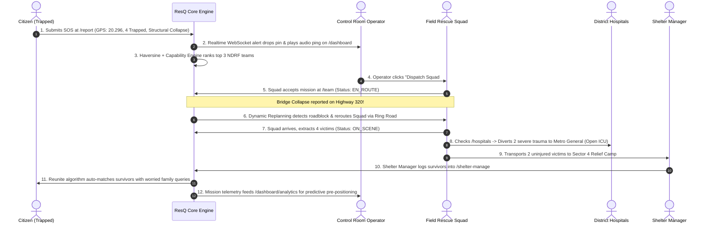

# 🛡️ ResQ — Comprehensive User Roles, Operational Workflows & Government Impact Guide

> **Prepared for Team Pitch & Evaluation Judges**  
> *Target System: ResQ Real-Time Disaster Intelligence & Autonomous Dispatch Platform*  
> *Active Localhost URL: `http://localhost:3000`*

---

## Executive Summary

During catastrophic disasters (flash floods, earthquakes, structural collapses, cyclones), **70% of casualties occur within the first 120 minutes** (the "Golden Hours"). 

Traditional government disaster response suffers from:
1. **Siloed Communication**: Police, Fire, NDRF, SDRF, and district hospitals operate on separate radios and phone lines.
2. **Phone Line Saturation**: Dial-in 112/108 lines jam within minutes, leaving hundreds of trapped citizens stranded.
3. **Reactive Guesswork**: Rescue squads are dispatched blindly without knowing if roads are submerged or if receiving hospitals have empty ICU beds.

**ResQ replaces chaotic paper and phone chains with an autonomous, real-time coordination loop connecting 4 core user roles.**

---

## 1. User Roles Breakdown & Website Portals

```
+-----------------------------------------------------------------------------------+
|                                  RESQ PLATFORM                                    |
+-----------------------------------------------------------------------------------+
|                                                                                   |
|  1. CITIZEN             2. OPERATOR             3. FIELD SQUAD      4. SHELTER    |
|  (Trapped / Family)    (Incident Commander)     (NDRF / Fire / EMS)   (Relief Mgr)|
|       |                     |                         |                  |        |
|  [/report, /reunite]   [/dashboard, /map]           [/team]      [/shelter-manage]|
|       |                     |                         |                  |        |
|  Instant SOS          Multi-Factor Dispatch     Turn-by-Turn GPS   Camp Inventory |
|  Family Reunite       Gemini AI Copilot         Hazard Rerouting   Survivor Intake|
|  Open Shelters        Predictive Learning       On-Scene Triage    Auto-Match DB  |
|                                                                                   |
+-----------------------------------------------------------------------------------+
```

---

### Role 1: Citizen (General Public & Trapped Victims)
* **Website Pages**: `/report`, `/citizen`, `/reunite`
* **Target Audience**: Anyone trapped in a building, stranded in rising floodwaters, or searching for separated family members.

#### What Work They Do on the Website:
1. **Zero-Friction Emergency SOS (`/report`)**:
   - **No login or account creation required** (saving crucial minutes during an emergency).
   - Tap emergency category: *Flood, Fire, Structural Collapse, Landslide, Earthquake, Medical*.
   - One-tap GPS Geolocation capture (`Get Current Coordinates`).
   - Specify number of people trapped and optional photo or short voice note.
   - Click **"SEND REPORT"** → instantly receives a tracking code (e.g., `INC-1018`).
2. **Track Rescue Status (`/citizen`)**:
   - Victims can view real-time status changes: `VALIDATED` → `EN_ROUTE` → `ON_SCENE`.
   - View local district safety broadcasts and find the nearest verified open shelter with available beds.
3. **Reunite Separated Families (`/reunite`)**:
   - Report a missing relative (Name, Age, Clothing, Last Known Location).
   - Browse or search safe shelter intake lists to confirm if a relative has checked in safely.

#### How It Helps the Government:
- **Eliminates Call Center Gridlock**: Converts hundreds of frantic phone calls into structured, deduplicated GPS points on a map.
- **Accurate Resource Sizing**: Knowing exact trapped counts (e.g. 1 person vs 12 people) prevents sending a 2-person ambulance when a 10-person boat squad is needed.

---

### Role 2: Control Room Operator (District Incident Commander)
* **Website Pages**: `/dashboard`, `/dashboard/map`, `/dashboard/replanning`, `/dashboard/analytics`
* **Target Audience**: District Collector, Magistrate, NDRF Duty Officer, State Disaster Management Authority (SDMA).

#### What Work They Do on the Website:
1. **Global Tactical Map (`/dashboard/map`)**:
   - Visualizes all active incidents, severity heatmaps, and positions of all rescue units on interactive OpenStreetMap tiles.
   - Live incoming SOS alerts ping audibly and update via WebSockets with zero page refreshes.
2. **Automated Multi-Factor Dispatch Engine**:
   - ResQ automatically calculates the top 3 best-suited rescue squads using a multi-factor mathematical formula:
     $$\text{Score} = (\text{Haversine Distance}) + (\text{Equipment Capability Match}) + (\text{Squad Fatigue/Capacity})$$
   - Example: A structural collapse requires heavy concrete cutters; ResQ suppresses simple water-rescue teams and prioritizes the nearest specialized Urban Search & Rescue (USAR) unit.
   - With 1 click, the commander confirms dispatch.
3. **Dynamic Roadway Replanning (`/dashboard/replanning`)**:
   - If a bridge collapses or an underpass floods, the operator triggers a road severance. The system immediately reroutes all en-route rescue teams with recalculated alternate routes.
4. **Gemini AI Commander Copilot**:
   - Operates as a 24/7 AI tactical advisor. Synthesizes all simultaneous emergencies, detects hospital bed bottlenecks, and outputs prioritized P0/P1/P2 action directives.
5. **Continuous Learning & Predictive Staging (`/dashboard/analytics`)**:
   - Audits past disaster missions. Identifies high-risk zones (e.g., Ward 12 masonry vulnerability, Sector 3 lowland) and pre-stages boats and supplies **12 hours before** rain hits.

#### How It Helps the Government:
- **Shrinks Dispatch Latency from 45 min to < 15 sec**: Eliminates phone tag between police dispatchers and field stations.
- **Prevents Command Blind Spots**: Gives the District Magistrate a single unified screen showing the entire district's operational health.

---

### Role 3: Field Rescue Squad (NDRF / SDRF / Fire / EMS)
* **Website Pages**: `/team`
* **Target Audience**: NDRF Battalion commanders, Fire brigade personnel, Ambulance drivers, State Disaster Rapid Action Forces.

#### What Work They Do on the Website:
1. **Mobile-First Mission Console (`/team`)**:
   - Mounted on tablets in rescue vehicles or mobile phones.
   - Receives instant audio chime and modal pop-up when a mission is assigned.
2. **Live Waypoint Navigation & Hazard Avoidance**:
   - Displays turn-by-turn route to the incident location.
   - If a road blockage occurs, the map recalculates the route automatically to avoid dead-ends.
3. **On-Scene Casualty Triage Updates**:
   - Upon arrival, the team taps **"Arrived on Scene"** (`ON_SCENE`).
   - Counts rescued victims and marks mission status (`RESOLVED`).
   - If casualties require ICU admission, the squad queries live hospital telemetry (`/hospitals`) to transport patients directly to hospitals with open beds, bypassing crowded ones.

#### How It Helps the Government:
- **Zero Radio Interference**: GPS tracking is streamed directly to the command center without clogging emergency radio channels.
- **Safer Rescue Personnel**: Prevents rescue vehicles from driving directly into flash floods or collapsed bridges due to real-time dynamic rerouting.

---

### Role 4: Shelter & Camp Logistics Manager
* **Website Pages**: `/shelter-manage`, `/reunite`
* **Target Audience**: Relief Camp In-Charge, Red Cross coordinators, Municipal revenue officers running community centers, sports complexes, or schools.

#### What Work They Do on the Website:
1. **Live Bed & Supply Census (`/shelter-manage`)**:
   - Updates total capacity, occupied beds, and remaining capacity in real time.
   - Monitors inventory levels: Drinking water (litres), food rations (person-days), medical kits, and sanitation supplies.
   - When a shelter hits 90% capacity, the system automatically redirects incoming buses of evacuated citizens to the nearest under-utilized camp.
2. **Survivor Identity Registration (`/reunite`)**:
   - Registers evacuated survivors upon entry (Name, Age, Gender, Origin Ward, Medical Condition).
   - Instantly updates the centralized reunification database.
   - Cross-references missing person reports; when a match is found (e.g., child matched to mother), alerts both parties with secure verification codes.

#### How It Helps the Government:
- **Prevents Resource Imbalance**: Stops the common issue where one relief camp is overcrowded with no food, while another camp 3 km away sits empty with surplus rations.
- **Immediate Family Peace-of-Mind**: Resolves missing person panics, freeing police from manual missing person searches.

---

## 2. End-to-End Workflow: A Real Disaster Scenario

Here is how the 4 roles interact seamlessly during a **Flash Flood & Building Collapse**:



---

## 3. High-Value Answers for Evaluation Judges

### Why is ResQ uniquely valuable to Governments?
1. **Inter-Agency Interoperability**: In traditional systems, Police, Fire, NDRF, and Municipalities use incompatible software. ResQ provides a unified web-native standard that works on any browser without software installation.
2. **Automated Triage Scoring**: Human operators get fatigued and make mistakes during disasters. ResQ’s multi-factor matching ensures the right team with the right gear gets sent to the right incident every time.
3. **Infrastructure-Resilient Navigation**: Traditional navigation apps (Google Maps) do not account for active disaster severed roads. ResQ's dynamic replanning algorithm closes roads instantly across the fleet.
4. **Predictive AI Loop (Continuous Learning)**: Instead of only being reactive, ResQ uses previous disaster data and Gemini AI to tell commanders where to stage rescue boats *before* the disaster strikes.

---

## 4. Quick Reference: Demo Accounts & Passwords

All demo accounts are pre-configured with password: **`ResQ@2026!`**  
*(Or simply use the **⚡ 1-Click Demo Login** buttons on `/login`)*

| Role | Email | Direct URL | Focus for Demo |
|---|---|---|---|
| **Control Room Operator** | `operator@resq.gov` | `/dashboard` | Command Map, Dispatch Queue, Gemini AI Copilot |
| **Field Rescue Squad** | `field@resq.gov` | `/team` | Live Navigation, Roadblock Rerouting, On-Scene Triage |
| **Shelter Manager** | `shelter@resq.gov` | `/shelter-manage` | Bed Capacity, Relief Supplies, Survivor Intake |
| **Citizen** | `citizen@resq.org` | `/report` & `/citizen` | Zero-Login SOS, Family Reunification |
